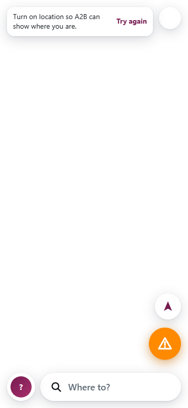
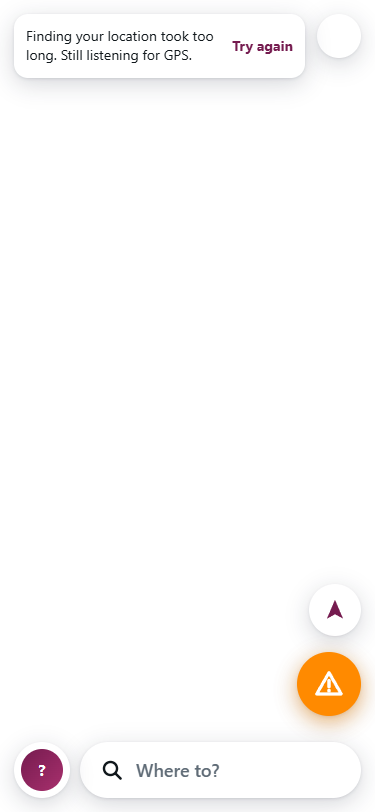

# One location watcher and clear recovery states

Review base: upstream `main` at `134045abe40e3fd50f73fb24437c4ef4a2920509`, fetched on 2026-10-29. This branch starts directly from upstream and does not include the separate bounded GPS estimate change.

All 41 PRs were refreshed before implementation. The new open search PR #41 and updated #11 do not provide this geolocation lifecycle fix. No existing feature PR was repackaged here.

## Problem reproduced

The previous `startLocation()` discarded the watch ID. Every timeout could queue another retry without clearing the still-live watch. Using the upstream functions with mocked geolocation, five repeated timeout callbacks queued five timers, then produced six simultaneous watchers. A timeout also set `locationDenied`, despite permission not being refused.

## Changes for review

- `public/location.js`: one controller owns the watch ID and retry timer. Repeated starts are idempotent. A transient error retains the watch; only before any position exists does one 15-second timer replace it, clearing the old watch immediately before replacement; manual retry and page cleanup cancel pending work. Generation checks discard callbacks from replaced watches, including late successes and late error/retry callbacks. Watch ID zero and synchronous startup errors are handled.
- Permission denial waits for a deliberate retry. Timeout and temporary unavailability keep listening. Only first acquisition retries after 15 seconds; a fix received during the wait cancels the retry. Inaccurate fixes keep the same watcher so a better fix can recover without registering another watch. Unsupported browsers can still use the map to plan.
- `public/app.js` and `public/core.js`: track acquiring, denied, timeout, unavailable, inaccurate and ready separately. Failure remains visible in the browse banner even if an old position exists. Recenter uses the current status when no position is available. Page hide releases the watcher/timer; page restore resumes a previously started watcher, except after denial or an unsupported API. Hiding a tab does not deliberately stop active navigation.
- `public/index.html` and `public/styles.css`: announce the status through a polite live region, show retry only for actionable failures and provide a 44 px minimum retry target using the existing visual style.
- `public/sw.js`: include the new location module in the offline shell and advance the shell version to v40, preserving upstream suggest.js.
- `test/location.test.js`: mocked API behavior and execution of the actual app lifecycle functions cover repeated starts/errors, successful recovery, old cached positions, invalid coordinates, unsupported APIs, cancellation, manual retry and page restore. Every sequence asserts a maximum of one watcher and one timer.

The lifecycle follows the browser's [Geolocation specification](https://www.w3.org/TR/geolocation/): clear a watch using its returned ID and distinguish denial, unavailability and timeout by error code. Error messages come from the app instead of displaying browser diagnostic text. The UI/UX Pro Max error-recovery guidance informed the actionable messages and live status announcement.

## Validation

- `npm test`: 185 passed, 0 failed on 2026-10-29. Existing transit, navigation and search tests pass.
- `node --check public/app.js` and `git diff --check`: passed.
- Chrome component smoke used the actual HTML/CSS, location module and extracted app lifecycle functions, with mocked geolocation and timers. It covered acquiring, timeout, denial, inaccurate, success and unavailable states; keyboard retry; cached-position failure; page cleanup/resume; light/dark appearance; and 320, 375 and 812 px viewport widths. Maximum active watchers: 1; maximum pending retries: 1; page errors: 0.
- Browser harness: `work/m2-gps-browser.mjs` in the review workspace. Screenshots: `outputs/m2-gps/denied-mobile.png` and `outputs/m2-gps/inaccurate-night-mobile.png`. These are local review artifacts, not production changes.
- The browser smoke bypasses map/app boot and stubs geolocation. Real permission prompts, hardware GPS, device background behavior and an on-road drive have not been tested. Public map/routing services and production data were not called.

## Rendered comparison

The same synthetic timeout (code3) rendered through the actual upstream failure function and current
controller/status function at375px. Map boot and real geolocation are omitted in both component fixtures.
The baseline implies permission is off; the new banner says the request timed out and GPS is still listening.

| Before | After |
|---|---|
|  |  |

Submitted for owner review; no CLA acceptance, merge or deployment.

## Review follow-up — 2026-10-30

- Addressed [review 5709612817](https://github.com/thaqif0709/a2b/pull/49#pullrequestreview-5709612817). Merged upstream `7ff9dda` into this branch; retained suggestion imports/shell entry, landscape layout and train changes.
- A timeout/unavailable callback no longer stops a working watch. A tunnel-exit fix is accepted immediately on the same watch. No automatic replacement occurs after the app has any position, including a cached one. Permission denial still stops and waits for manual Retry.
- New regressions cover immediate tunnel-exit recovery, a first fix cancelling a pending retry, and cached app positions. Existing concurrency/callback tests now assert that a watch stays active until actual replacement.
- `npm test`: exit 0, **201 passed, 0 failed, 0 skipped** (Node 24.22.1). `node --check` for app/location/service worker, `git diff --check`, and `git merge-tree --write-tree upstream/main HEAD`: exit 0.
- Chrome component smoke rerun: widths 320/375/812, keyboard Retry, page lifecycle, day/night, immediate recovery after transient failure; maximum one watch and one timer, no page errors. Refreshed timeout screenshot below uses current text.
- Browser scope remains actual components with synthetic GPS and blocked external network, not full-map boot, physical permission/GPS or an on-road test.
