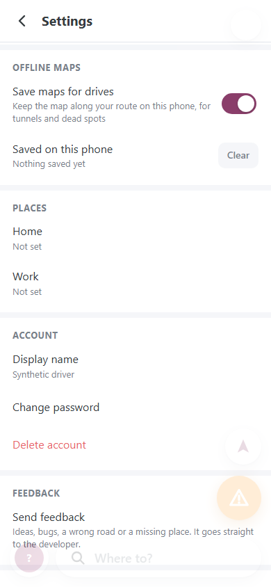
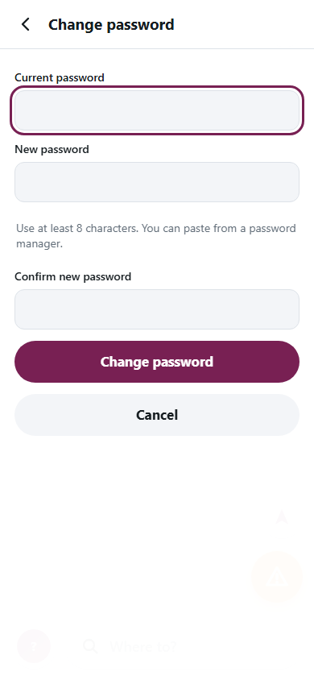
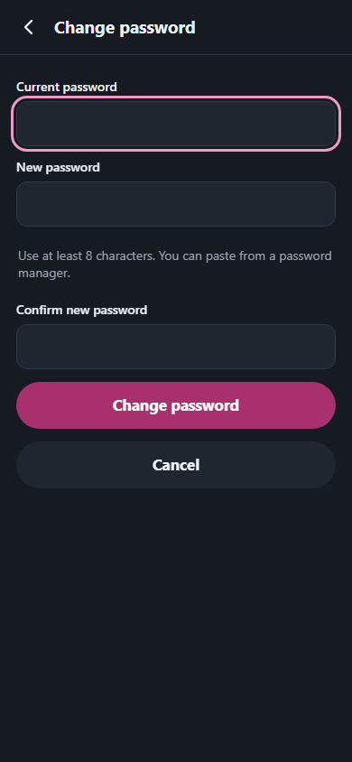

# Safe place text and password changes

Based on upstream `134045abe40e3fd50f73fb24437c4ef4a2920509`. No framework or provider change.

## Review update — 30 October 2026

- Merged upstream `7ff9dda` into this PR branch in response to [review #5709613590](https://github.com/thaqif0709/a2b/pull/45#pullrequestreview-5709613590).
- Resolved the `route-preview.js` conflict by keeping `showRouteLoading` and upstream's updated auto-start
  comment and behavior: Drive/Motorbike may auto-start, while Walk/Train wait for Go. Closure fallback still
  requires explicit start. The password form and other upstream changes remain intact.
- On the merged code: `npm test` exit 0, **191 pass / 0 fail / 0 skip**; `npm run test:browser` exit 0,
  **10 pass** across Chromium and WebKit. Syntax checks for `app.js`, `panels.js`, and `route-preview.js`, and
  `git diff --check` pass. Browser coverage remains the local synthetic component tests described below.
- Historical counts below describe the original submission. No new feature, upstream merge, deployment or
  production configuration change was performed for this review update.

## Problem and changes

- `openPreview()` interpolated an origin name into HTML while loading routes. A harmless synthetic
  `<b>` place name produced an element in the original sink. The new `showRouteLoading()` creates
  a decorative spinner and a separate text node; the same string now remains literal text.
- Settings → Change password used browser `prompt()`. Replace it with a labelled form containing
  current/new/confirmation password inputs and password-manager autocomplete. Paste remains allowed.
- Validate required current password, minimum new length and confirmation; focus the invalid field
  and associate the error. Reset old error associations before validating a later attempt.
- Disable inputs/actions and expose `aria-busy` while saving; repeated submit events cannot send
  another request. API errors appear as text in a focusable alert with retry available.
- Cancel/success return focus to the Settings action. Back/Escape through `closePanel()` clears
  password values; late results cannot reopen a closed panel or leave passwords in hidden inputs.
- Reuse existing colours/layout. Add a visible focus outline and readable error text in both themes.
- Add development-only Playwright 1.62.1 and component integration tests. No browser library is
  shipped to users and no generated map data is required. Pin matches the locally available browser
  runtime; initial 1.64.1 attempt could not launch its uninstalled browsers and was replaced.

Malformed-cookie handling is submitted separately with atomic recovery; this PR has no auth backend
or migration changes. Existing report/address/feedback templates inspected during this audit use
`esc()`/text output; these tests target the proved origin sink, not a claim of a comprehensive XSS audit.

## Reproduction and verification

Windows, Node 24.22.1, npm 12.2.1. `npm ci`: exit 0. `npm test`: exit 0, **179 pass / 0 fail / 0 skip**.
`npm run test:browser`: exit 0, **10 pass** (5 scenarios each in Chromium and WebKit).
`node --check public/app.js`, `node --check public/panels.js`, `git diff --check`: exit 0.

Run locally:

```sh
npm ci
npx playwright install chromium webkit # only if these optional development browsers are absent
npm run test:browser
```

The test server binds only to 127.0.0.1 and serves real HTML/CSS/ES modules without app/map boot.
External requests are blocked and account API responses are synthetic. Tests cover harmless HTML,
masking/autocomplete, validation correction, deferred success/error, duplicate submit, focus restoration,
close before submit/late failure, and overflow at 320/360/375/390/430/768/1280 widths, landscape,
day/night, reduced motion and 200% component text enlargement.

The before/after capture also confirmed the baseline native prompt event and 1 injected node before
versus 0 after, with no page exceptions (Chromium 151.0.7922.34). It did not capture a native dialog
image. Below, “before” is the actual Settings entry screen, followed by the new form with empty fields.
All content is synthetic. No password, code, token, feedback or private location appears in captures.

| Before: Settings entry | After: day | After: night |
|---|---|---|
|  |  |  |

Limits: component integration is not a full map/search/drive journey or physical iPhone test. Native
software keyboard, OS Dynamic Type, screen-reader speech and on-road navigation remain manual.
Full app global reduced-motion handling and general panel focus restoration remain separate work.
The existing API client has no request deadline; bounded API requests are a separate lifecycle PR.
No before/after latency improvement is claimed.

`npm ci` reported three existing Wrangler-chain advisories (miniflare/undici/wrangler: two moderate,
one high), also present without Playwright. No automatic dependency upgrade was mixed into this fix.
Runtime package install hooks are blocked by this machine's npm policy; browser tests and unit tests
passed, while Wrangler local validation is recorded in the separate recovery PR.

No production changes or CLA acceptance. Review against the separate owner/tester and recovery PRs
because each also edits `panels.js`; integrate and rerun tests before merging.
