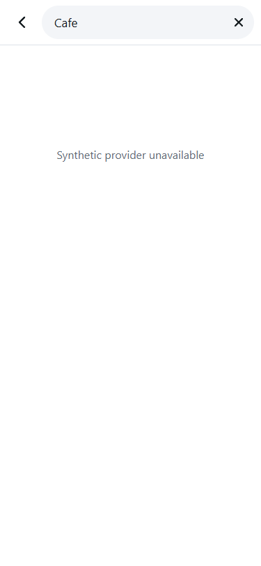
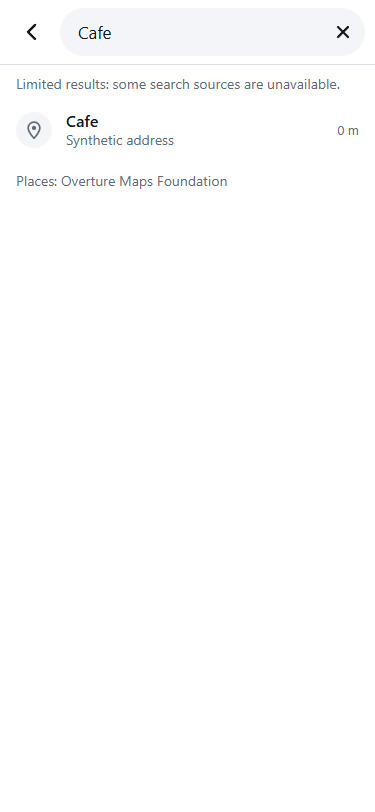

# Search request lifecycle and partial results

## Base and scope

Independent branch from upstream `134045abe40e3fd50f73fb24437c4ef4a2920509`, checked on 2026-10-29.
No M1 changes, framework change, paid provider, production configuration, or deployment is included.

## Review update — 30 October 2026

- Merged upstream `7ff9dda` into this branch for [review #5709613908](https://github.com/thaqif0709/a2b/pull/47#pullrequestreview-5709613908).
- Preserved upstream's approved driver places, name/distance ranking via `best()`, and `isHidden` filtering
  of removed or corrected places. Passed `onUnavailable` through the index, category server and file lookups.
- Updated the search VM fixture for upstream's `syncDriverPlaces()` call. Added two behavioral regressions:
  approved places survive index/provider failure, and hidden names stay absent after sources recover.
- `npm test`: exit 0, **213 pass / 0 fail / 0 skip**. `node --check public/app.js`, `node --check public/places.js`
  and `git diff --check`: exit 0. No assertions or earlier regressions were skipped.
- Chrome and WebKit local component smoke passed again: stale Enter after Clear/Back, focus, partial results,
  explicit selection, guest Recent, deduped Enter, genuine empty state and portrait/landscape. Verified the new
  upstream “Add missing place” button remains. The old exact-text empty-state locator was updated because
  that button is now inside the status container; the empty-message and button are both asserted. Zero page
  errors; external requests blocked. This remains component coverage, not a physical-device/full-map test.
- #41 is now merged with a different scope: approved driver suggestions, **without the Google fallback**.
  Its prior description below is historical. #51 and #53's subsequent UI/train changes are also preserved.
- [#58](https://github.com/thaqif0709/a2b/pull/58), reviewed head `1a4951a86100e89c5c4bcd7da6479f348b174c9c`,
  remains open and changes `searchNearby`/`mergeResults` for malls and addresses. Whichever PR lands second
  must merge current main again and preserve both ranking and lifecycle/error behavior; no #58 code is copied.
- The stalled-provider deadline limitation below remains deferred. No new theme, production change or CLA
  acceptance is included in this review update. Earlier test counts describe the original submission.

## Problems reproduced

An isolated execution of upstream's actual `runSearch` and `closeScreen` functions showed:

- A delayed Enter response still rendered after the search screen closed.
- A successful local place result disappeared when the server provider failed (`Promise.all` rejected).

## Changes

- Invalidate in-flight results immediately on every input edit, short query, Clear, close/Back, target change,
  and place selection. Cancel pending debounce timers, including when Clear is pressed before a request starts.
- Check the current query, search target, screen visibility and generation after asynchronous work. Obsolete
  responses cannot paint results, display errors, or trigger Enter's single-result selection.
- Keep search focus synchronous inside the opening tap, as required by #36. Guard the delayed focus fallback
  so it cannot focus a closed or replaced search.
- Capture the selected Home/Work target and close the selection screen before its save awaits. A late save
  cannot close or retarget a newly opened search.
- Settle independent search providers separately. Keep successful results when the other provider fails;
  show a limited-results notice and require an explicit pick for an incomplete singleton.
- Preserve named category results when the area lookup fails. Retain available parking/category data when
  an optional source fails.
- Report failed local index, advertised-area or shard fetches to search, retaining successful shards. Retry
  failed files on the next search while keeping successful responses cached. An absent optional dataset's
  index (404) stays quiet; an advertised file missing from that dataset counts as incomplete.
- Deduplicate the final ranked list across and within providers using the existing normalized-name and
  distance rule. Existing landmark ranking and `matchesWordStarts` remain in place.
- Preserve guest Recent and single-result Enter behaviour when all consulted sources complete successfully.

Existing provider requests may finish after invalidation; their results cannot affect another search. This
branch cancels pending debounce work without requiring the separate route request/abort helpers. Local file
promises are shared and cached; invalidating one search does not cancel another consumer's file load.

**M2-D remains partial.** A provider that never settles can still keep `Promise.allSettled` waiting, and a
cached pending local-file request can remain pending. This patch isolates completed failures; it does not
provide bounded deadlines or progressive results for stalled sources. Adding explicit search/provider
deadlines and integrating #11's progressive path are deferred. M2-B's optional API timeout does not apply
automatically to these search calls.

## Validation

- `npm test`: 199 passing tests, no failures (20 new regression cases).
- New deferred-provider tests execute the production application functions with synthetic time/providers and
  rendering callbacks: edit, short query, clear, close, target change, selection, out-of-order replies,
  category fallback, late Home save, partial failure, complete-empty and deduplicated results.
- Local-file tests exercise actual `places.js` imports with mocked fetch: 404/503 advertised shard failure,
  retained good shards, retry recovery, missing optional dataset, transient index failure and category source recovery.
- Chrome and WebKit component smoke used the actual search functions, index HTML, styles, core storage and
  place-search modules with local synthetic responses. Verified late Enter after Clear/Back, focus, a retained
  partial result, explicit selection, guest Recent, deduplicated complete Enter, genuine empty state and
  portrait/landscape layout. No browser exceptions; all external requests were blocked. Map boot was omitted.
- `git diff --check` passed. No real places database or production API was queried for these tests.

## Synthetic before and after

Both screenshots use Chrome at 375 × 812 with the same local fixture: search **Cafe**, a server response of
HTTP 503 (`Synthetic provider unavailable`), and one successful local result (`Cafe`, `Synthetic address`).
The harness executes the actual search functions, event handlers, modules, HTML and styles from the stated
revision. App/map boot is omitted and external requests are blocked; these are component captures, not a live-site test.

| Before: upstream `134045a` | After: `5a498c9` |
| --- | --- |
| Only the server error is shown; the successful local result is lost. | The local result remains selectable with a limited-results notice. |
|  |  |

## Historical integration notes — original 29 October submission

These were read before the original implementation. See the review update above for their current status:

- [#11](https://github.com/thaqif0709/a2b/pull/11), head `3287e0ba31bd434f099f30a5278fa7f9b8477aee`, now proposes
  merged OpenStreetMap/Overture/Foursquare **static place files**, with only approved additions/removals and
  suggestions in D1. Its earlier bulk-D1 architecture is superseded. It also changes `runSearch`, `searchByType`,
  `places.js` ranking and server request caching/cancellation. Preserve that ranking and progressive local-first
  display when reconciling; carry these generation and incomplete-result checks across.
- [#41](https://github.com/thaqif0709/a2b/pull/41), head `1fea54cf2c5ebce3f4db5dc379d94b3586ee3da9`, adds an optional
  Google UI Kit last resort after both existing searches complete. It changes `showResults` and adds delayed
  frame creation plus an asynchronous reverse lookup after a pick. Those callbacks need the same current-search
  guard when integrated; a partial or intermediate result must not start the fallback early. This branch neither
  introduces nor removes its Google policy, quota, attribution or storage behaviour.
- [#36](https://github.com/thaqif0709/a2b/pull/36) is already on the base. Immediate keyboard focus, loading
  placeholders and guest history are preserved. The broader train and route work in that PR is untouched.

Submitted for owner review; no CLA assent, merge or deployment.
